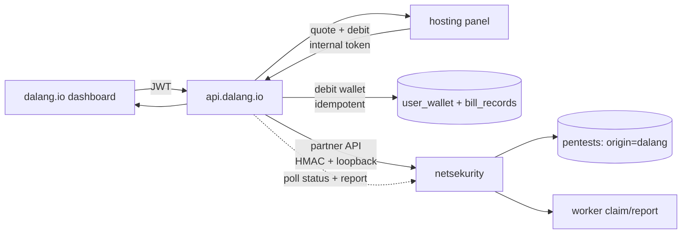
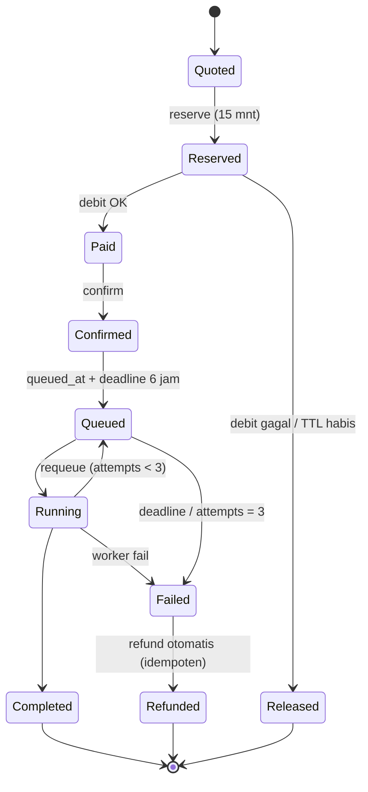

# Rencana integrasi scan Netsekurity ke platform Dalang

> Status: **rencana, belum diimplementasikan.** Keputusan pemilik per 2026-10-23.
> Dokumen ini adalah sumber kebenaran untuk desain; kontrak rinci per endpoint
> menyusul sebelum kode ditulis.

## Tujuan

Pelanggan `dalang.io`, `api.dalang.io`, dan `hosting.dalang.io` yang memiliki
domain terverifikasi bisa memindai domainnya dengan mesin scan Netsekurity.
Harga khusus: **NET Rp 10.000 per scan** (PPN Rp 1.100, debit wallet Rp 11.100),
bukan harga kredit default Netsekurity (1 kredit = 1 scan, $50).

## Keputusan yang sudah dikunci

| # | Keputusan | Nilai |
|---|---|---|
| D1 | Harga | NET Rp 10.000 + PPN Rp 1.100 = **gross Rp 11.100** |
| D2 | Domain `.svc.dalang.io` / subdomain platform | **Tidak boleh** — hanya domain milik pelanggan |
| D3 | Refund saat gagal | **Otomatis**, idempoten per `scan_id` |
| D4 | TTL reservasi | 15 menit (konfigurabel sampai 60 menit) |
| D5 | Pengiriman laporan | **Signed URL** berumur pendek dari Netsekurity |
| D6 | Antrean worker | Satu lane bersama, tanpa prioritas terpisah |
| D7 | Batas terminal | **6 jam** sejak `queued`, maksimum **3 attempt** |
| D8 | Autentikasi scan | Fase 1 **JWT-only**; token API per-user belum ada di api.dalang.io |

## Arsitektur

**Dalang = merchant of record; Netsekurity = fulfilment.** Uang dan identitas
tetap di api.dalang.io. Netsekurity tidak pernah memegang kredensial wallet dan
tidak masuk `INTERNAL_ALLOWED_SOURCE_CIDRS` / `INTERNAL_SERVICE_TOKEN` — surface
internal api.dalang.io memercayai pemanggil untuk menyebut `user_id` siapa pun.

Semua status/callback provider berakhir di **api.dalang.io**. Panel tidak
menerima callback pihak ketiga; ia hanya polling api.dalang.io.

## Matriks eligibilitas domain

| Surface | Domain yang boleh | Bukti kontrol |
|---|---|---|
| dalang.io VPS | custom domain `status=active` | aktivasi Cloudflare (DNS+TLS) — proof type dicatat |
| dalang.io deploy | deployment domain `active` | idem |
| hosting panel | `service_domain` yang dibeli lewat Dalang | registrar `Active` + TXT `_netsekurity` (panel menulis record sendiri bila mengelola DNS) |
| hosting panel | `hosting_domains` addon | TXT `_netsekurity` |
| Netsekurity langsung | apa pun | TXT yang sudah ada |
| **Dilarang** | `<uuid>.svc.dalang.io`, subdomain platform, `*.dalang.io`, domain tanpa bukti | — |

Konsekuensi: pelanggan VPS/container tanpa custom domain tidak bisa scan sampai
memasang dan memverifikasi satu. UI harus menjelaskan ini, bukan menyembunyikan
tombol.

Klaim platform tidak pernah menggantikan bukti kontrol. Go hanya bisa membuktikan
domain VPS/deployment yang `active` di Cloudflare; domain panel adalah baris DB
tanpa challenge DNS.

## Urutan transaksi

`quote (NET 10.000, PPN 1.100, gross 11.100)`
→ `reserve ke Netsekurity (15 menit, tidak masuk antrean)`
→ `wallet/debit idempoten`
→ `confirm ke Netsekurity (baru queued)`
→ worker → `completed` / `failed`.

- Debit gagal atau quote kedaluwarsa → `release` reservasi, tidak ada uang berpindah.
- Confirm gagal setelah debit → retry idempoten, lalu refund otomatis + alert.
- Worker fail → Netsekurity menandai `failed` dan **tidak** me-refund kredit
  (`billing_source` gate); refund wallet dilakukan api.dalang.io.

### State machine dan batas terminal

Evaluator deadline adalah poller api.dalang.io (cabang primary-task `:8801`),
bukan Netsekurity. Setelah `Refunded` tidak ada transisi keluar; refund kedua
ditolak oleh `UNIQUE(scan_id)`.

`requeueStaleRunning` Netsekurity (recovery 45 menit) tetap ada tetapi berhenti
di attempt ke-3: setelah itu `failed`, bukan `queued` lagi.

## Kontrak API

### Netsekurity — partner API (HMAC, loopback)

| Method/path | Fungsi |
|---|---|
| `POST /api/partner/v1/scans/reserve` | `{external_order_id, external_user_id, domain, proof_type, idempotency_key}` → `{scan_id, status=reserved, expires_at}` |
| `POST /api/partner/v1/scans/{id}/confirm` | `reserved → queued` (hanya setelah debit) |
| `POST /api/partner/v1/scans/{id}/release` | `reserved → cancelled` |
| `GET /api/partner/v1/scans/{id}` | status, attempts, deadline_at, ringkasan severity, `report_ready`, `failure_reason` |
| `GET /api/partner/v1/scans/{id}/report` | PDF via signed URL berumur pendek |

Autentikasi: HMAC-SHA256 atas timestamp + nonce + body, replay window, plus
allowlist loopback. Bukan `INTERNAL_SERVICE_TOKEN`.

### api.dalang.io

| Method/path | Auth | Fungsi |
|---|---|---|
| `POST /api/v1/scans` | JWT | Buat quote `scan`, reserve, debit, confirm, fulfilment |
| `GET /api/v1/scans` / `GET /api/v1/scans/{id}` | JWT | Daftar/status |
| `GET /api/v1/scans/{id}/report` | JWT | Redirect ke signed URL |
| `POST /internal/v1/quote` (kind `scan`) | `quote:read` | Harga dari katalog server |
| `POST /internal/v1/wallet/debit` | `wallet:debit` | Debit quote-backed (tidak berubah) |
| `GET /internal/v1/scans?user_id=` | `scan:read` | Panel polling status |
| `POST /internal/v1/netsekurity/events` (opsional) | `scan:events` | Callback push, terminasi tetap di api.dalang.io |

## Aturan uang

- Harga dan eligibilitas hanya hidup di katalog api.dalang.io dan disajikan lewat
  quote. dalang.io dan panel merender nilai dari respons API — tidak ada angka di
  i18n, template, atau helper harga.
- Debit selalu memakai gross (Rp 11.100). PPN dihitung server-side dengan
  truncation yang sudah ada (`ComputePPN`).
- Idempotensi DB-backed: `UNIQUE(user_id, idempotency_key)` pada `scan_orders`,
  key yang sama diteruskan ke Netsekurity.
- Refund memakai `refundWalletTx` (kembali ke lot asal) dengan alasan baru
  `SCAN_FAILED`; baris harga asli tidak diubah.
- Jangan menambah jalur debit baru di luar `debitWalletTx`/quote.

## Model data

| Repo | Tabel | Isi |
|---|---|---|
| api.dalang.io | `scan_orders` | `id, user_id, domain, channel, status, price_net, ppn, price_gross, quote_id, debit_id, bill_id, provider_scan_id, idempotency_key, queued_at, deadline_at, attempts, closed_reason, report_ref, failure_reason`; `UNIQUE(user_id, idempotency_key)`, `UNIQUE(provider_scan_id)` |
| api.dalang.io | `scan_refunds` | `scan_id UNIQUE`, `refund_id`, `amount`, `created_at` |
| Netsekurity | `partner_accounts` | `platform, external_user_id, user_id` (shadow user, email sintetis) |
| Netsekurity | `partner_requests` | replay protection per idempotency key |
| Netsekurity | `domains` | tambah `verified_by ('txt'|'partner')`, `verified_ref` |
| Netsekurity | `pentests` | tambah `origin ('self'|'dalang')`, `billing_source`, `external_order_id`, `attempts`, `deadline_at` |

Catatan Netsekurity: `users.email` dan `google_sub` UNIQUE, jadi shadow user
memakai email sintetis (`platform+<uuid>@partner.invalid`) agar tidak bertabrakan
dengan login Google di masa depan.

## Pekerjaan per repo

### api.dalang.io

1. Quote kind `scan` (harga server-side, PPN per line).
2. `scan_orders` + `scan_refunds` + migrasi up/down.
3. Fulfilment type `scan` di `runPaidFulfilment` **dan** `fulfilmentIsRecognised`.
4. Endpoint publik `POST/GET /api/v1/scans` + endpoint internal `GET /internal/v1/scans`.
5. Poller status + evaluator deadline/attempt di cabang primary-task `:8801`.
6. Refund otomatis dengan alasan `SCAN_FAILED`.
7. Specs + tests (wajib per aturan repo).

### Netsekurity

1. Partner API `reserve/confirm/release/status/report` + HMAC + replay store.
2. `partner_accounts` + shadow user.
3. `verified_by`, `origin`, `billing_source`, `attempts`, `deadline_at`.
4. Gate refund kredit di `handleWorkerFail` berdasarkan `billing_source`.
5. Stop requeue di attempt ke-3.
6. Rate-limit bypass khusus partner yang terautentikasi.
7. Tests + dokumentasi operasional.

### hosting.dalang.io

1. Quote kind `scan` di enum panel.
2. Aksi "scan domain" + verifikasi TXT otomatis bila panel mengelola DNS.
3. Halaman status (pola `hosting_jobs`, fragment polling).
4. i18n en/id/zh + tests + `api_meta` (rute terdokumentasi).

### dalang.io

1. Tombol scan di kartu custom domain VPS/deploy.
2. Halaman status + polling.
3. i18n en/zh/id.
4. Render harga dari quote.

## Keamanan dan penyalahgunaan

- Scan hanya untuk domain dengan bukti kontrol; assertion dicatat (proof type,
  waktu, pelaku).
- Blocklist target platform: `*.dalang.io`, `netsekurity.com`, host infrastruktur.
- Batas in-flight per user tetap 1; tambahkan batas harian per akun dan alert
  bila ada pola gagal berulang.
- Laporan hanya lewat signed URL; `/reports/` Netsekurity tetap owner/admin.

## Observability

- Metrik: queue depth, umur job tertua, attempts, tingkat gagal per `closed_reason`,
  refund rate, latency reserve→confirm.
- Alert: order melewati deadline, refund gagal, confirm gagal berulang, queue
  depth di atas ambang.

## Testing

- Uang: NET/PPN/gross tepat, double-submit idempoten, saldo kurang → 402 tanpa
  debit, refund otomatis tepat sekali, `vps_price_audit` tetap 0.
- Kepemilikan: domain tak terverifikasi ditolak; domain user lain ditolak;
  blocklist platform ditolak.
- Kontrak: replay HMAC di luar window ditolak; idempotency key sama mengembalikan
  respons yang sama; provider timeout tidak meninggalkan debit tanpa reservasi.
- Deadline: 6 jam / 3 attempt menutup order dan me-refund.
- E2E staging. Netsekurity belum punya lingkungan staging — perlu instance kedua
  (port/DB terpisah) agar kontrak bisa diuji tanpa menyentuh produksi.

## Urutan rollout

1. Netsekurity partner API + model + gate refund (bisa diuji sendiri).
2. api.dalang.io: quote kind, `scan_orders`, fulfilment, poller, endpoint publik.
3. dalang.io UI + i18n.
4. hosting panel UI + verifikasi TXT.
5. E2E staging, canary akun internal, observability, lalu buka umum.

## Item terbuka

- Dukungan token API per-user untuk scan CI/CD. api.dalang.io hari ini hanya
  punya JWT dan `APP_API_KEY` internal (LXD); menambahkannya adalah fitur
  terpisah (penerbitan token, scope, audit).
- ETA scan di UI: worker adalah satu cron per menit; angka ETA harus berasal dari
  metrik antrean, bukan janji statis.

## Referensi

- api.dalang.io: `handlers/internal_wallet.go`, `handlers/internal_quote.go:260-315`,
  `handlers/fulfilment.go:82-191`, `handlers/wallet.go:216,865,996`,
  `handlers/admin_invoice.go:22-49`, `middleware/internal.go:197-338`,
  `migrations/20261012120000_*.up.sql`.
- hosting.dalang.io: `panel/src/quote.rs:230-620`, `panel/src/wallet_client.rs`,
  `panel/src/hosting_domain.rs:643-886`, `panel/src/webhooks.rs:41-174`,
  `docs/31-wallet-debit.md`, `docs/34-runbook-control-plane.md`.
- dalang.io: `src/lib/components/vps/VPSCustomDomainsCard.svelte`,
  `src/routes/dashboard/services/+page.server.ts`, `src/hooks.server.ts`,
  `src/lib/api-client.js`.
- Netsekurity: `pentests.go:20-330`, `domains.go:1-113`, `apitokens.go:179`,
  `AGENT_WORKER.md`, `pricing.go:18-45`.
